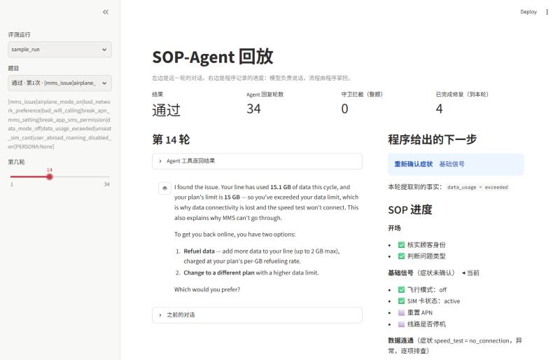
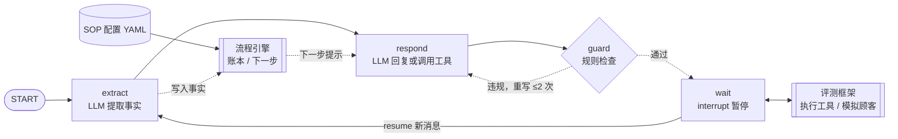

# SOP-Agent：让企业客服 Agent 按标准流程稳定执行的可控引擎

企业客服、IT 支持、售后等场景都有标准作业流程（SOP）：先查什么、再做什么、什么情况下才能转人工。把整份 SOP 塞进提示词、交给大模型自己执行，在几十步的长流程里容易跳步、提前放弃，而且每次结果不一样。

本项目把 **“流程进度”从模型里拿出来，交给程序管理**：模型负责理解顾客和组织语言，通用流程引擎负责记录进度、决定下一步，规则守卫负责拦截违规操作。业务流程写在 YAML 配置里。引擎支持两种流程形状：**排障**（症状 → 按路径逐项检查和修复）和**请求清单**（一通电话里的多个请求逐个办理）；同一种形状的新业务只需写配置。

在 Sierra 发布的 Agent 评测基准 [τ²-bench](https://github.com/sierra-research/tau2-bench) 的电信技术支持领域（工具调用 + 远程指导用户操作，单题最多上百轮）上做了对照实验：

- **测试集 pass^3（同一题 3 次都成功）从 77.5% 提升到 95.0%**，pass^1 从 89.2% 到 97.5%
- 3 次全部成功的题从 31/40 增加到 38/40；转人工率从 39.2% 降到 30.0%
- 每次运行 Agent 费用约 $0.017，提示缓存命中率约 92%

在第二个领域**零售**（退货、换货、取消、改地址，每个请求只有三四步）上也接入了引擎，但**没有带来提升**：训练集单次运行 62/74，基线 68/74。差异主要来自模拟顾客提前结束和选品推理，而不是漏步骤。结论是：这种做法适合**步骤多、带嵌套子流程**的长流程，对短流程帮助不大，详见[零售](#第二个领域零售没有提升)。

**回放界面**：逐轮查看对话，以及程序记录的事实、当前该做的 SOP 步骤、已完成的修复和守卫拦截。仓库自带 3 道题的录制（[demo/sample_run](demo/sample_run)），不用 API Key 也能看。



**MCP Server**：同一个流程引擎也以 [MCP](https://modelcontextprotocol.io) 服务的形式提供（[src/sop_agent/mcp_server.py](src/sop_agent/mcp_server.py)），任何支持 MCP 的 Agent 都能接入它做“流程导航”：把对话中得到的事实告诉引擎，引擎返回下一步，调用工具前先问守卫是否允许。详见下方[接入 MCP](#接入-mcp)。



## 要解决的问题

以电信技术支持为例：顾客的手机没信号、上不了网或发不了彩信。客服 Agent 要一边调用后台工具（查账户、充值流量、开通漫游、恢复线路），一边远程指导顾客在手机上逐项检查和修复。一道题里可能同时藏着多个故障，要按官方排障流程走几十步。

τ²-bench 自带的 Agent 把整份流程交给模型，靠模型自己记住走到了哪一步。在训练集上逐题分析失败对话后发现：

- **嵌套子流程被跳过**：9 道失败题中，有 8 道是彩信题，都没有查流量用量。流量检查在“上网问题”子流程里，而彩信流程要求先走完这个子流程。
- **没走完就放弃**：失败题全部以转人工结束，Agent 说“都查过了”，其实还有步骤没做。

所以问题不在于模型不懂，而在于长流程里没有可靠的“排查进度”。

## 设计：流程由程序掌控，语言由模型负责

```text
顾客或工具的新消息
  → 提取：模型把自然语言转成事实（如 airplane_mode=on）
  → 账本：程序记录已查的事实和已完成的修复
  → 下一步：通用流程引擎按 SOP 配置算出下一个必须做的步骤
  → 回复：模型根据内部提示，回复顾客或调用工具
  → 守卫：程序检查关键规则（流程没走完不准转人工、该转人工时必须转、充值上限）
```

- **通用流程引擎**（[src/sop_agent/flow.py](src/sop_agent/flow.py)）：只认“事实、路径、项目”三个概念，不含任何电信知识。规则包括：症状正常就跳过整条路径；修好一项后所有症状清空，必须重新检查；只有流程允许时才能转人工。
- **SOP 配置**（[flows/telecom.yaml](flows/telecom.yaml)）：把官方排障流程图写成配置，注释里标出原文的步骤编号。
- **引擎接口**（[src/sop_agent/engines.py](src/sop_agent/engines.py)）：LangGraph 图只通过这个接口使用引擎，排障引擎和请求清单引擎（[src/sop_agent/requests.py](src/sop_agent/requests.py)、[flows/retail.yaml](flows/retail.yaml)）都实现它。能从工具结果读出的信息（身份、订单状态、写操作是否成功）由代码记录，不交给模型。
- **LangGraph 实现**（[src/sop_agent/graph.py](src/sop_agent/graph.py)）：τ²-bench 每次只要 Agent 的一条消息，图在 `interrupt()` 处暂停交出回复，收到下一条消息后用 `Command(resume=...)` 继续，账本由检查点保存。
- **缓存友好**：下一步提示只临时附在请求最后，不写入对话历史，固定的店规前缀保持不变，缓存命中率约 92%。

详细设计、实验记录和每一处修改的原因见 [docs/DESIGN.md](docs/DESIGN.md)。

## 结果

**测试集（40 题，基线和本项目在同一天、相同设置下各跑 3 次，2026-11-12）：**

| 指标 | 基线 | 本项目 |
|---|---|---|
| pass^1（单次成功率） | 89.2% | **97.5%** |
| pass^2（随机 2 次都成功） | 81.7% | **95.8%** |
| pass^3（3 次都成功） | 77.5% | **95.0%** |
| 3 次全部成功的题 | 31/40 | **38/40** |
| 转人工率 | 39.2% | 30.0% |
| 单题消息数（中位） | 48 | 54.5 |
| 单题耗时（中位） | 51 秒 | 100 秒 |
| Agent 费用（每次运行） | $0.004–0.038（无缓存数据，给区间） | $0.017 |

pass^k 按 τ-bench 论文定义计算：每题跑 n 次、成功 c 次，pass^k = C(c,k)/C(n,k)，再对所有题取平均。基线随着 k 增大从 89.2% 降到 77.5%，本项目只从 97.5% 降到 95.0%，**提升主要体现在稳定性上**。

- **提升来自哪里：** 40 道题中有 8 道两者结果不同，其中 7 道是彩信题，本项目 3 次都成功，基线只成功 1–2 次。这和训练集上发现的“嵌套子流程被跳过”一致。
- **本项目更差的题：** 1 道合同到期停机题，本项目 1/3，基线 2/3。Agent 查明原因后先向顾客解释，没有立即转人工，顾客随即结束了对话；那一刻账本里还没把停机原因记成“合同到期”，所以守卫没有拦下。训练集上也出现过同样的问题，修改后没有完全解决。
- **另一次失败：** 1 道欠费停机题，顾客已确认付款请求，Agent 却转了人工，没有完成缴费和恢复线路（基线同样 2/3）。
- 守卫在 1851 轮中拦截 10 次，其中 4 次重试后仍被放行。
- 按事先定好的规则，看到测试集结果后没有再修改 Agent。

**训练集（74 题，各跑 1 次，用于开发和调参）：**

| 指标 | 基线 | 本项目 |
|---|---|---|
| 成功率 | 65/74（87.8%） | 72/74（97.3%） |
| 转人工率 | 23.0% | 12.2% |
| 单题消息数（中位） | 55 | 68 |
| 单题耗时（中位） | 67 秒 | 132 秒 |
| Agent 费用（每题） | $0.005–0.045（无缓存数据，给区间） | $0.020 |

训练集结果用于开发，修改是根据训练集的失败题做的，不能作为最终成绩。

### 第二个领域：零售（没有提升）

零售的流程形状和电信不同：一通电话里顾客常有多个请求，每个请求都要“找到订单 → 查状态 → 收集细节 → 列出细节请顾客明确确认 → 执行”。为此给引擎加了“请求清单”这种形状和对应的守卫规则（先核实身份、订单状态必须允许、顾客明确同意后才能执行写操作、同一订单的换货或改商品只能做一次）。基线和本项目都使用 τ²-bench 自带的零售店规。

**训练集（74 题，各跑 1 次）：**

| 指标 | 基线 | 本项目 |
|---|---|---|
| 成功率 | 68/74（91.9%） | 62/74（83.8%） |
| 转人工率 | 14.9% | 9.5% |
| 单题消息数（中位） | 22.5 | 24.5 |
| 单题耗时（中位） | 34 秒 | 59 秒 |
| Agent 费用（每题） | $0.004–0.024（无缓存数据，给区间） | $0.013 |

基线是更早一次的运行（同一模型和设置，不是同一天）。两者结果不同的 10 道题里，本项目改好 2 道（104 靠的正是下表里后来撤回的那句提示，110 这次选对了地址），退步 8 道。62/74 是撤回那句提示之前的结果，撤回后没有再完整跑一遍。逐题看退步的原因：

| 原因 | 题数 |
|---|---|
| 模拟顾客在说“是的”的同一句话里结束了对话，Agent 来不及执行（基线走的流程相同） | 3 |
| 选错商品或退款原因、漏选商品 | 3 |
| 为另一道题加的提示让 Agent 多改了付款方式（已撤回） | 1 |
| 顾客在最后一句话里才要求转人工 | 1 |

**结论：** 零售每个请求只有三四步，基线很少漏步骤；失败主要来自推理和模拟顾客的随机性，流程引擎管不到。电信是几十步、带嵌套子流程的排障，基线最常见的错误正是跳步和提前放弃，所以提升明显。考虑到训练集已经看不到提升，**零售没有跑测试集**，以上数字只来自训练集的单次运行。

开发中的两个教训也记在这里：
- 第一版有一个“政策不允许”的请求类型，提取模型开始替 Agent 判断请求是否合法，把合法请求标成不允许，在 8 道难题上只通过 2 道。删掉后，判断交还给回复模型，同样 8 道通过 5 道。
- 零售的提取规则比电信复杂，开着思考模式时一次提取会想 7000 多个 token（JSON 本身只有几百个），费用是电信的两倍多。零售的提取改为关闭思考（`extract_thinking: false`），电信保持评测时的设置不变。

## 评测设置

- τ²-bench 固定在提交 `c06b07d`（2026-11-10），只作为评测环境使用，代码未修改。
- Agent、模拟顾客和评分模型都使用 DeepSeek（`deepseek/deepseek-flash`），温度 0。**因此分数不能和官方排行榜直接比较**，只能比较本项目和同设置下的基线。
- 基线是 τ²-bench 自带的 `llm_agent`，和本项目拿到相同的资料（店规 + 分步流程图）。
- 使用官方的训练/测试划分。测试集只在最后跑一次，基线和本项目在同一天、相同设置下各跑 3 次。

## 运行

需要 Python 3.12 和 [uv](https://docs.astral.sh/uv/)。

```bash
git clone https://github.com/sierra-research/tau2-bench vendor/tau2-bench
git -C vendor/tau2-bench checkout c06b07d
uv venv --python 3.12 .venv
uv pip install --python .venv/Scripts/python.exe -e vendor/tau2-bench -e ".[dev,demo,mcp]"
```

复制 `.env.example` 为 `.env`，填入 `DEEPSEEK_API_KEY`。

离线测试，不调用模型：

```bash
.venv/Scripts/python -m pytest
```

打开回放界面（不调用模型，不产生费用）：

```bash
.venv/Scripts/streamlit run demo/app.py
```

跑评测（会产生费用，运行前可用 `scripts/check_balance.py` 查余额）。中文 Windows 需要先设置 `PYTHONUTF8=1`，否则 τ²-bench 读资料文件时会按 GBK 解码报错；设置 `SOP_TRACE_PATH` 才会记录回放需要的每轮轨迹：

```bash
PYTHONUTF8=1 SOP_TRACE_PATH=outputs/my_run/trace.jsonl .venv/Scripts/python scripts/run_tau2.py run --domain telecom --agent sop_agent_workflow --task-split-name test --agent-llm deepseek/deepseek-flash --user-llm deepseek/deepseek-flash --communicate-scorer substring --num-trials 3 --save-to outputs/my_run
```

`--save-to` 的相对路径按 τ²-bench 的数据目录计算，结果实际保存在 `vendor/tau2-bench/data/simulations/outputs/my_run/`。要回放时把其中的 `results.json` 复制到 `outputs/my_run/`，和 trace 放在一起。

对比两次运行：

```bash
.venv/Scripts/python scripts/compare_runs.py outputs/<基线>/results.json outputs/<本项目>/results.json
```

## 接入 MCP

服务端通过 stdio 运行，不调用模型：

```bash
.venv/Scripts/python -m sop_agent.mcp_server
```

在 Claude Desktop、Cursor 等客户端的 MCP 配置里加入（路径换成本机的绝对路径）：

```json
{
  "mcpServers": {
    "sop-engine": {
      "command": "D:/path/to/tau-service-agent/.venv/Scripts/python.exe",
      "args": ["-m", "sop_agent.mcp_server"]
    }
  }
}
```

| 工具 | 作用 |
|---|---|
| `get_flow` | 流程定义：可记录的事实及取值、问题类型、各条路径 |
| `start_case` | 为一段对话开工单，返回第一步 |
| `record_facts` | 记录事实，返回下一步；从故障值变为正常值算一次修复，所有症状要重新确认 |
| `record_fix_tool` | 报告自己用修复工具（如开通漫游）修好了问题 |
| `check_action` | 发出回复或调用工具前问守卫：流程没走完不准转人工、该转人工时必须转、充值上限 |
| `get_case` | 已知事实、已完成修复、各路径进度 |

资源 `sop://flows/{flow}` 返回流程的 YAML 原文。不调用模型的演示（按剧本走一遍彩信排障）：

```bash
.venv/Scripts/python scripts/mcp_demo.py
```

和评测时的区别：评测中的 Agent 用一次模型调用从对话里提取事实；通过 MCP 接入时，事实由接入的 Agent 自己判断，引擎只负责进度、下一步和守卫。**MCP 接入方式没有在 τ²-bench 上单独评测过**，上面的成绩来自内嵌在 LangGraph 中的版本。MCP 目前只提供排障类流程，工具是按“事实 → 下一步”设计的，请求清单（零售）还没有接入。

## 项目结构

```text
src/sop_agent/
  engines.py   引擎接口：图只通过它使用流程引擎
  flow.py      排障流程引擎（事实、路径、项目、账本）
  requests.py  请求清单引擎（零售：多个请求逐个办理）
  extract.py   从对话中提取事实
  guard.py     守卫规则
  graph.py     LangGraph 状态图
  agent.py     接入 τ²-bench 的 Agent，记录用量和轨迹
  usage.py     读取缓存命中数，计算费用
  replay.py    把对话和轨迹对上，计算每轮的 SOP 进度
  mcp_server.py  把流程引擎和守卫作为 MCP Server 提供
demo/app.py          Streamlit 回放界面（demo/sample_run 是自带的录制）
flows/telecom.yaml   电信 SOP 配置（排障）
flows/retail.yaml    零售 SOP 配置（请求清单）
scripts/             评测、费用、对比、余额脚本，以及 MCP 演示
tests/               离线测试
docs/DESIGN.md       设计文档和实验记录
```

## 局限

- 只在电信上有提升。零售接入了引擎，但训练集单次运行比基线低（62/74 对 68/74），没有跑测试集；零售需要给引擎新增一种流程形状，不是只换一份配置。
- 事实提取依赖模型，可能出错或慢一步。合同到期题在训练集和测试集上都因此失败过：提取先把“合同到期”记成“欠费”，或者还没记下停机原因，Agent 就先向顾客解释，错过了转人工的时机。
- 比基线慢一倍左右：每轮多一次提取调用，而且会把流程走完。
- 守卫触发很少（测试集 1851 轮中拦截 10 次），主要提升来自流程引擎的下一步提示。没有单独做“去掉守卫”的对照实验。
- 训练集上的修改是根据失败题逐条做的，最后几处修改只做了小批量验证，没有再完整跑一遍训练集。
- 模拟顾客也是 DeepSeek，和真实用户不同；题目数量有限，结论不能直接推广。

## 致谢

评测环境来自 [τ²-bench](https://github.com/sierra-research/tau2-bench)（MIT 许可证）。
